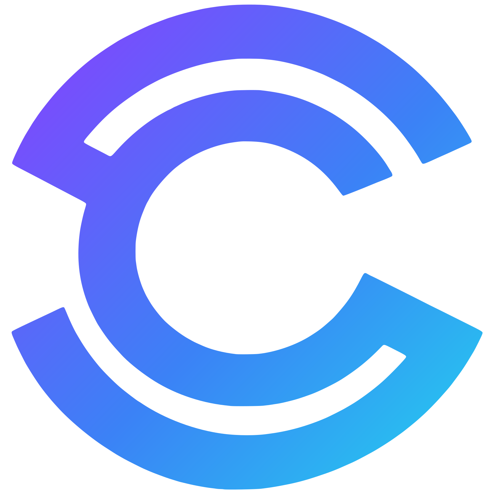

<p align="center"></p>

<h1 align="center">Circlle</h1>

> Escalas sem planilha e sem grupo de WhatsApp bagunçado: abra as datas, receba a disponibilidade dos membros, monte a escala e avise todo mundo. Um PWA para projetos sociais, ONGs, bandas, coletivos, escolas e qualquer grupo que se organiza em escalas.


📄 **[Documentação completa do projeto →](docs/documentacao.md)**

---

## 🎯 O problema

Quem já coordenou voluntários conhece a rotina: a escala sai numa planilha ou numa foto no grupo, o coordenador passa dias perguntando quem pode em cada data, alguém avisa em cima da hora que não vai e ninguém sabe ao certo quem confirmou.

E montar uma boa escala não é só rodiziar nomes. É saber quem faz o quê, colocar quem está começando ao lado de quem já tem experiência e não chamar sempre as mesmas pessoas.

O **Circlle** nasceu da experiência real de coordenar escalas de música voluntária, e foi pensado para **qualquer grupo** que trabalha com escalas.

## 💡 Propósito

Ferramentas de gestão costumam ser caras e feitas para grandes organizações. O Circlle é contratado pela organização com **valor acessível** e é **gratuito para os membros**, com foco em organizações pequenas, de periferia e de baixa renda, que também merecem tecnologia boa.

---

## 🔄 Como funciona

1. O grupo **solicita** o Circlle e, depois de aprovado, quem solicitou vira **Administrador**.
2. O administrador cria os **departamentos** e promove membros a **Coordenadores**, um ou mais por departamento.
3. O coordenador configura o departamento e envia o **código** dele pelo WhatsApp.
4. O membro digita o código, marca **o que faz** (violão, foto, reparo elétrico…) e o coordenador aprova.
5. O coordenador **abre as datas**, e cada membro marca **"posso nestes dias"**.
6. O coordenador monta a escala, na mão ou com **sugestão automática**, ajusta e **publica**.

---

## ✨ Funcionalidades

**Escalas**
- **A escala do mês no Início**, em tabela, como a imagem que o grupo mandava no WhatsApp, com o seu nome em destaque
- **Nova escala avulsa, semanal ou mensal**: as datas já aparecem, é só ajustar e criar
- **Uma tela por função**: cada papel vê só o que usa, e o perfil abre pelo avatar
- **Permissões no perfil do membro**: a coordenação libera quem pode montar escalas ou repertórios
- **Calendário pessoal**: o mês com tudo marcado (escalado, datas abertas, “posso” marcado) e a lista de todas as escalas
- **Disponibilidade**: o membro marca as datas em que pode, em vez de ser cobrado um por um
- **Publicar o mês inteiro** de uma vez, ou enviar antes a prévia
- **Montar a escala em 3 passos**: quem vai, o que cada um faz e revisar
- **Várias funções por pessoa** na mesma data, como tocar e cantar
- **Prévia**: a equipe confere a escala e confirma ou pede ajuste antes de publicar
- **Notificações no celular**: datas abertas, prévia, escala publicada ou alterada, pedidos de entrada e de ajuste, e lembrete na véspera
- **WhatsApp**: mande a escala de uma data, a escala do mês ou as datas para marcar
- **Sugestão automática** em rodízio e **ensaios** (em breve)

**Repertório** (módulo opcional por departamento)
- **Repertório como playlist**: músicas em ordem, com o tom de cada uma, aplicado nas datas da escala
- Música, artista, tom e link num **banco privado** da organização, com busca rápida
- Atalho para a cifra no Cifra Club; **troca de tom** automática em breve

**Departamento**
- Entrada por **código**, com aprovação do coordenador
- **Funções de cada membro** registradas e editáveis no perfil
- **Nomes do seu grupo**: troque “Departamento”, “Evento” e “Função” pelas palavras que vocês usam
- **Mural de avisos** (em breve)
- **Acompanhamento de desempenho**, visível só aos coordenadores

---

## 🧩 Vocabulário

| No Circlle | Exemplos |
|---|---|
| Organização | Coletivo, ONG, banda, escola |
| Departamento | Música, Mídia, Zeladoria |
| Evento | Apresentação, ação social, plantão |
| Função | Violão, foto, reparo elétrico |

Os termos são neutros, e **cada organização pode renomeá-los** para a sua própria linguagem.

## 👥 Perfis

**Todo mundo entra como Membro**, e o acesso é liberado por quem está acima. Os papéis valem **por departamento**: a mesma pessoa pode coordenar a Mídia e ser membro da Música.

| Perfil | Quem libera | O que faz |
|---|---|---|
| **Administrador** | Equipe do Circlle | Gerencia a organização e promove coordenadores |
| **Coordenador** | Administrador | Configura o departamento, aprova membros, abre eventos e publica escalas |
| **Membro** | Coordenador | Marca disponibilidade, vê suas escalas no calendário, confirma ou pede ajuste |
| **Permissão de repertório** | Coordenador | Membro que monta e envia o repertório (coordenadores já podem sempre) |

---

## 🎨 Identidade visual

Modo escuro como padrão, gradiente vibrante e formas arredondadas, com o **círculo** como elemento central da marca.

O símbolo é um **"C" envolvido por um círculo**: a equipe no centro e as pessoas ao redor, girando como o rodízio da escala. As versões (gradiente, cor única, branca, escura e ícone do app) ficam em [`assets/logo/`](assets/logo/), e os ícones do PWA em [`public/icons/`](public/icons/). Os tokens ficam em [`src/styles/tokens.css`](src/styles/tokens.css), com modo claro automático.

| Papel | Cor |
|---|---|
| Gradiente da marca | `#8B3DFF` → `#3B82F6` → `#22D3EE` |
| Fundo / cards (escuro) | `#0F1B33` / `#1A2847` |
| Fundo / cards (claro) | `#F5F7FB` / `#FFFFFF` |
| Destaque | `#FB923C` |

| Status da escala | Cor |
|---|---|
| Confirmado | `#22C55E` |
| Pendente | `#FB923C` |
| Prévia | `#8B3DFF` |
| Pediu ajuste | `#F43F5E` |

---

## 🛠️ Tecnologias previstas

- **PWA** instalável, com notificações push gratuitas
- **Supabase:** Auth, PostgreSQL e Storage, com **Row Level Security** isolando os dados de cada organização
- **LGPD:** termo de uso no cadastro e exclusão de conta e dados pelo próprio usuário

---

## 🚀 Rodando localmente

```bash
git clone https://github.com/rafaelmestre/Circlle.git
cd Circlle
npm install
cp .env.example .env   # preencha com a URL e a chave publishable do Supabase
npm run dev
```

**Banco de dados:** crie um projeto no [Supabase](https://supabase.com) e rode [`supabase/schema.sql`](supabase/schema.sql) no **SQL Editor**. Para dados de teste, rode também [`supabase/seed-teste.sql`](supabase/seed-teste.sql). Quem já tem dados roda só as migrações que faltam, que não apagam nada: [`migracao-v3.sql`](supabase/migracao-v3.sql) (v2 → v3), [`migracao-v4.sql`](supabase/migracao-v4.sql) (v3 → v4), [`migracao-v5.sql`](supabase/migracao-v5.sql) (lembrete na véspera, depois de publicar a função), [`migracao-v6.sql`](supabase/migracao-v6.sql) (permissão de montar escalas) e [`migracao-v7.sql`](supabase/migracao-v7.sql) (repertórios).

**Notificações (opcional):** gere as chaves com `npx web-push generate-vapid-keys`, coloque a pública em `VITE_VAPID_PUBLIC_KEY` no `.env`, cadastre `VAPID_PUBLIC_KEY`, `VAPID_PRIVATE_KEY` e `VAPID_SUBJECT` nos *secrets* das Edge Functions do Supabase e publique a função [`supabase/functions/notificar`](supabase/functions/notificar/index.ts) com *Verify JWT* desligado (ela confere o login sozinha). Sem isso, o app funciona normalmente, só sem os avisos.

## 📁 Estrutura

```
Circlle/
├── index.html
├── vite.config.js        # Vite + PWA (manifest e service worker)
├── src/
│   ├── main.js           # telas e roteamento pela sessão
│   ├── lib/              # Supabase, contexto, interface e notificações
│   ├── telas/            # uma tela por arquivo
│   └── styles/           # tokens.css (design) e main.css
├── public/               # favicon, ícones e push-sw.js (notificações)
├── supabase/             # schema, migrações, dados de teste e functions/notificar
├── assets/logo/          # versões do logo
└── docs/                 # documentação do projeto
```

---

## 🗺️ Roadmap

**Fundação**
- [x] Marca, logo, paleta e tokens de design
- [x] Protótipo navegável
- [x] Projeto Vite + PWA, publicado no Netlify
- [x] Banco com Row Level Security
- [x] Documentação v7

**Etapa 1: MVP**
- [x] Solicitação e aprovação de organização
- [x] Papéis, departamentos e entrada por código
- [x] Datas abertas e disponibilidade
- [x] Escala em 3 passos, com várias funções por pessoa
- [x] Prévia, confirmação e pedido de ajuste
- [x] Escala do mês e calendário pessoal
- [x] Painel do Circlle
- [x] Notificações push
- [x] Nomes do grupo, departamentos desativados e WhatsApp
- [x] Lembrete na véspera
- [x] Uma tela por função: escala do mês no Início, aba Escalas (avulsa, semanal, mensal) e permissões no perfil do membro

**Etapa 2**
- [ ] Sugestão automática de escala
- [ ] Ensaios
- [x] Repertório como playlist, aplicado nas datas
- [ ] Mural e cifra própria

**Etapa 3**
- [ ] Desempenho e relatórios
- [ ] Sincronização com agenda e troca de tom

---

## 👤 Autor

**Rafael Mestre A. Araujo**: estudante de Análise e Desenvolvimento de Sistemas (PUC Minas), coordenador de escalas de música voluntária e fundador da **Cappstone Studio**.

- GitHub: [@rafaelmestre](https://github.com/rafaelmestre)
- Instagram: [@cappstonestudio](https://instagram.com/cappstonestudio)